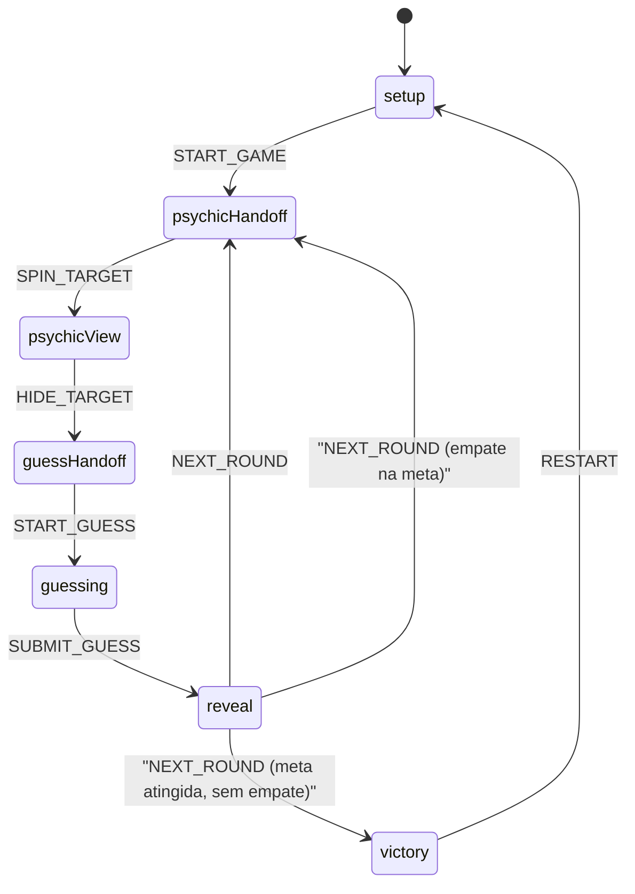

# Lógica do jogo Sintonia

## Decisões já tomadas

- **Testes:** Vitest + React Testing Library + jsdom, com cobertura via `@vitest/coverage-v8` e limite de 80% em linhas, funções, branches e statements. A API é compatível com a do Jest.
- **Pontuação:** o alvo tem 3 faixas. A central vale 6, as duas adjacentes valem 4 e as duas externas valem 2. Fora delas, 0. O Psíquico ganha 50% do que o palpite fez (3, 2, 1 ou 0), então o placar continua sempre inteiro.
- **Dica:** é falada em voz alta, sem campo no app.
- **Vitória (confirmada):** a vitória é checada ao fim de cada rodada. Se alguém atingir ou passar da meta, vence quem tiver mais pontos. Se os dois empatarem com a meta atingida, o jogo continua com rodadas normais, alternando o Psíquico, até o fim de uma rodada sem empate. Durante o desempate, a tela de jogo mostra o aviso "Desempate!".
- **Navegação:** sem router. O estado global define a tela atual (`setup`, `game` ou `victory`).
- **Aparelho único:** como os dois jogadores usam o mesmo celular, haverá telas de "passe o aparelho" entre o Psíquico e quem dá o palpite, para o alvo não vazar.
- **Ponteiro:** controle deslizante (`input range`) que começa no centro (90°). O arrasto no dial fica para o refino de UI.
- **Encerrar partida:** botão "Encerrar partida" na tela de jogo, com confirmação, que volta ao início.
- **Como jogar:** janela simples com o texto das regras, acessível no início e no jogo.

## Referência ([furkankoykiran/wavelength](https://github.com/furkankoykiran/wavelength), MIT)

- **O que aproveitamos:** os 101 pares de conceitos em português, revisados para pt-BR, e a largura total de 40° do alvo.
- **O que fazemos diferente:**
  - A referência não tem meta, Psíquico nem tela de vitória. Nós temos os três.
  - Na referência, o alvo fica visível logo no início da rodada. Aqui ele só aparece depois de girar a roleta, e há telas de "passe o aparelho".
  - Na referência, "Próxima Rodada" pode ser usada antes da revelação. Aqui ela só existe depois.
  - A referência sorteia conceitos com repetição. Aqui é um baralho sem repetição.
  - A referência empilha tudo na vertical. Aqui o layout é landscape: dial no centro, conceitos nas laterais e placar e botões nas bordas.
- **Fora do escopo:** tema claro/escuro e vários idiomas.

## Fluxo de estados

A ação `ABORT_GAME` (Encerrar partida) leva de qualquer fase do jogo de volta a `setup`.

## Regra de hooks e utils

- **Hooks:** todo arquivo que usa recursos do React (`useState`, `useReducer`, `useContext`, `useEffect`, `useMemo` etc.) e funciona como hook fica em `src/hooks/`, com o nome começando por `use`, por exemplo `useGameActions.ts`. Os testes ficam ao lado, como `useGameActions.test.tsx`.
- **Utils:** um arquivo `.ts` com lógica reutilizável que não usa estado nem recursos do React é uma função utilitária comum. Ele fica em uma pasta `utils/` e não leva o prefixo `use`.
- **Tipos e constantes:** não são hooks nem utils, então ficam em `src/types/` e `src/constants/`.

## Camada de domínio (pura, sem React)

Toda a lógica de jogo é composta de funções puras, então fica em `src/utils/game/`. Os tipos ficam em `src/types/` e as constantes em `src/constants/`.

- [src/types/game.ts](src/types/game.ts): `Player { id: 0 | 1; name; score }`, `Spectrum { left; right }`, `RoundPhase`, `Round { psychicId; spectrum; targetAngle; guessAngle | null; guesserPoints; psychicPoints }`, `GameState { screen; players; targetScore; round; roundNumber; spectrumDeck; winnerId | null }`.
- [src/constants/game.ts](src/constants/game.ts): o dial vai de 0° a 180°. As meias-larguras das faixas são `ZONE_6 = 4°`, `ZONE_4 = 12°` e `ZONE_2 = 20°`. A meta padrão é 10 pontos, com limite de 5 a 50. O tamanho máximo do nome é 20 caracteres.
- [src/utils/game/scoring.ts](src/utils/game/scoring.ts): `getGuessPoints(target, guess)` retorna 6, 4, 2 ou 0, e `getPsychicPoints(points)` retorna `points / 2`.
- [src/utils/game/target.ts](src/utils/game/target.ts): `spinTarget(random = Math.random)` sorteia o centro do alvo entre 20° e 160°, para que a faixa inteira caiba no dial. O gerador aleatório é injetado para os testes.
- [src/constants/spectrums.ts](src/constants/spectrums.ts): os 101 pares da referência (`js/clues.js`, chave `pt`), revisados para pt-BR, mais os seus exemplos (Quente/Frio, Chato/Divertido, Impopular/Popular), sem duplicatas.
- [src/utils/game/spectrumDeck.ts](src/utils/game/spectrumDeck.ts): `createDeck(random)` embaralha os pares com Fisher-Yates e `drawSpectrum(deck)` tira um par sem repetir, reembaralhando quando o baralho acaba.
- [src/utils/game/validation.ts](src/utils/game/validation.ts): `validateSetup(names, targetScore)` rejeita nomes vazios ou repetidos (depois de aparar espaços) e metas fora do limite. As mensagens de erro são em pt-BR.
- [src/utils/game/gameReducer.ts](src/utils/game/gameReducer.ts): função pura `(state, action) => state` que não usa hooks; o `useReducer` fica no provider. reducer com as ações `START_GAME`, `SPIN_TARGET`, `HIDE_TARGET`, `START_GUESS`, `SET_GUESS`, `SUBMIT_GUESS`, `NEXT_ROUND`, `RESTART` e `ABORT_GAME`. O `guessAngle` começa em 90°. Ações inválidas para a fase atual não mudam o estado. `NEXT_ROUND` troca o Psíquico (`psychicId` de 0 para 1 e vice-versa) e aplica a regra de vitória.
- [src/utils/game/victory.ts](src/utils/game/victory.ts): `resolveWinner(players, targetScore)` retorna o `id` do vencedor ou `null` quando ninguém atingiu a meta ou há empate. `isTiebreak(players, targetScore)` indica o empate com a meta atingida. Os testes cobrem: ninguém na meta, só um na meta, os dois na meta com placares diferentes, os dois empatados na meta e um desempate resolvido na rodada seguinte.

## Estado React

- [src/context/GameContext.tsx](src/context/GameContext.tsx): cria o contexto e o `GameProvider`, que usa `useReducer(gameReducer)` e expõe `state` e `dispatch`. Ele não exporta hooks.
- [src/hooks/useGameState.ts](src/hooks/useGameState.ts): lê o estado com `useContext` e dispara um erro em pt-BR se for usado fora do `GameProvider`.
- [src/hooks/useGameActions.ts](src/hooks/useGameActions.ts): devolve as ações já tipadas (`startGame`, `spinTarget`, `hideTarget`, `startGuess`, `setGuess`, `submitGuess`, `nextRound`, `restart`, `abortGame`), estabilizadas com `useMemo`.
- [src/hooks/useModal.ts](src/hooks/useModal.ts): controla abrir e fechar as janelas `HowToPlay` e `ConfirmDialog` com `useState`.
- [src/App.tsx](src/App.tsx): envolve tudo no `GameProvider` e escolhe `HomePage`, `GamePage` ou `VictoryPage` pela `screen` do estado.

## Componentes (Atomic Design, `src/components/`)

Cada componente tem sua própria pasta, com `Nome.tsx`, `Nome.module.scss` e `Nome.test.tsx`.

- **atoms/:** `Button` (modificadores `--primary` e `--secondary`, alvo de toque de pelo menos 44px), `TextInput`, `NumberInput`, `Heading`.
- **molecules/:** `FormField` (rótulo, campo e erro), `PlayerScore` (nome, pontos e selo de Psíquico), `SpectrumLabels` (lado A e lado B).
- **organisms/:**
  - `SetupForm`: os dois nomes e a meta.
  - `Scoreboard`: placar dos dois jogadores.
  - `Dial`: SVG de meio círculo com as faixas do alvo (`showTarget`) e o ponteiro (`guessAngle`).
  - `GuessControl`: `input range` de 0 a 180 que move o ponteiro. O arraste direto no dial fica para o refino de UI.
  - `HandoffPanel`: "Passe o aparelho para X".
  - `RevealPanel`: pontos da rodada e botão "Próxima rodada".
  - `Modal`: janela genérica, com fechamento pelo botão e pelo fundo.
  - `HowToPlay`: o texto das regras dentro do `Modal`.
  - `ConfirmDialog`: confirmação de "Encerrar partida", também usando o `Modal`.
- **templates/:** `ScreenTemplate`, o layout landscape que respeita as áreas seguras (`safe-area`).
- **pages/:** `HomePage`, `GamePage` (renderiza a fase da rodada atual) e `VictoryPage` (vencedor, placar final e botão "Jogar novamente", que dispara `RESTART`).

**BEM com CSS Modules:** as classes seguem `block__element--modifier` e são acessadas por `styles['button--primary']`. Cada arquivo `.module.scss` tem um único bloco, com o mesmo nome do componente em kebab-case.

## Testes e configuração

- `npm i -D vitest @vitest/coverage-v8 jsdom @testing-library/react @testing-library/user-event @testing-library/jest-dom`.
- [vite.config.ts](vite.config.ts): adicionar o bloco `test` com `environment: 'jsdom'`, `setupFiles: './src/test/setup.ts'`, `css.modules` e `coverage` com `thresholds` de 80. Ficam fora da cobertura `src/main.tsx`, `src/types/**` e `*.d.ts`.
- [package.json](package.json): novos scripts `test` (`vitest run`), `test:watch` e `test:coverage`.
- **Cobertura alvo:** perto de 100% em `src/utils/game/` (`scoring`, `target`, `spectrumDeck`, `validation`, `gameReducer`, `victory`), testes dos hooks com `renderHook` e testes de renderização e interação nos componentes. Haverá um teste de integração em `App.test.tsx` que joga uma partida completa com `random` mockado.

## Documentação

- Atualizar [AGENTS.md](AGENTS.md) com a estrutura Atomic, BEM, Vitest, a regra de hooks e utils (prefixo `use` em `src/hooks/`, funções sem estado do React em `utils/`) e o passo `npm run test:coverage` no checklist final.
- Criar regras em `.cursor/rules/`:
  - `code-conventions.mdc`, sempre aplicada: Atomic Design, BEM e nomes de componentes.
  - `hooks-and-utils.mdc`, aplicada a `src/hooks/**` e `src/**/utils/**`: a regra de nomes e pastas de hooks e utils.
